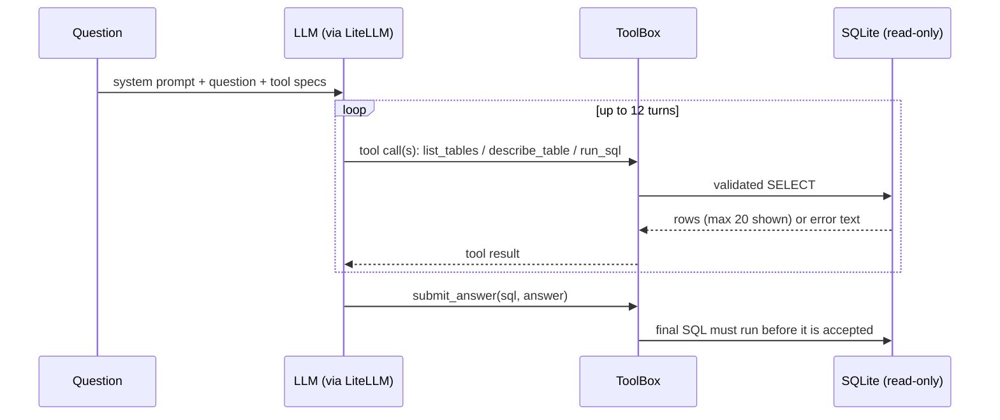

# sql-analyst-agent

An LLM agent that answers business questions about a SQLite database by inspecting the schema, testing queries and submitting a final SQL statement. It comes with an evaluation harness that grades the submitted SQL on its **result**, not its text, and logs every step of every run.

It runs on any model LiteLLM supports (OpenAI, Mistral, Gemini, Groq, local Ollama models, ...) and uses the [Chinook](https://github.com/lerocha/chinook-database) music-store database: 11 tables of artists, albums, tracks, customers, invoices and employees.

## Results

| Model | Exec. accuracy | Easy | Medium | Hard | LLM calls / q | Tool errors / q | Cost (USD) | p50 latency (s) |
|---|---:|---:|---:|---:|---:|---:|---:|---:|
| oracle (harness check) | 1.000 | 1.00 | 1.00 | 1.00 | 2.0 | 0.00 | 0.0000 | 0.00 |
| *your model here* | `make eval MODEL=...` | | | | | | | |

The **oracle** is a scripted fake model that calls one tool, then submits the gold SQL. It must score 100%, and CI checks that it does, so a failing model row means the model failed, not the grader. Real model rows are added by running `make eval MODEL=<litellm model>` followed by `make report`. No model numbers are listed until they come from a real run.

## How the agent works



- **Four tools**: `list_tables`, `describe_table` (columns, keys, foreign keys, 3 sample rows), `run_sql` (up to 20 rows), and `submit_answer`.
- **Errors go back to the model as text** and never crash the loop, so the model can fix a misspelled column and try again. Tool errors per question is a tracked metric.
- **Stop conditions are explicit**: `submitted`, `max_steps`, `no_submission` (the model answered in prose twice, even after one nudge), and `llm_error`.
- **No agent framework.** The loop is under 70 lines on LiteLLM's OpenAI-style tool calling, so every message is visible and testable.

### Safety

The SQL comes from a model, so it is treated as untrusted:

1. sqlglot must parse it as exactly **one** `SELECT` / `WITH` / `UNION` query. `DELETE`, `PRAGMA`, `ATTACH` and stacked statements like `SELECT 1; DROP TABLE x` are rejected.
2. The database is opened with `mode=ro` and `PRAGMA query_only = ON`, so writes fail even if a query slips past step 1. A test covers this.
3. A SQLite progress handler stops any query after 5 s, which covers runaway recursive CTEs and cross joins.

## Evaluation

[`data/questions.jsonl`](data/questions.jsonl) holds 30 questions (10 easy, 12 medium, 8 hard), each with a gold SQL query. Every gold query was run against the pinned database, and questions with ties at a "top N" cutoff were removed or rewritten so each has exactly one correct result.

**Grading is execution accuracy.** The predicted and gold queries both run, and their results must match:

- numbers are rounded to 2 decimals, so `213` equals `213.0`,
- row order counts only when the question asks for an order ("highest first"),
- column order doesn't count, and **extra columns are allowed**. Each gold column must map to a different predicted column with identical values, so returning `ArtistId, Name, Total` when asked for `Name, Total` still passes.

Each run writes `results/<model>.json` (summary plus per-question grades) and `results/trajectories/<model>.jsonl`, which contains every tool call, argument, output, token count, cost and latency. Reading the failed trajectories is the point of the exercise.

## Quickstart

```bash
pip install -e ".[dev]"
make data                                 # download Chinook (1 MB, pinned commit, SHA-256 checked)
make test                                 # 57 tests; LLM calls are scripted fakes
make eval MODEL=oracle                    # harness check, must be 1.000

export OPENAI_API_KEY=...
make eval MODEL=gpt-4o-mini               # or MODEL=ollama/qwen2.5:7b for a local model
make report                               # rebuilds results/leaderboard.md
sql-agent ask "How many customers bought at least one Jazz track?" -v
```

## Project layout

```
src/sql_agent/
  db.py        read-only connection, SQL validation, timeouts, pinned download
  tools.py     tool specs + dispatcher (errors returned as text)
  agent.py     the loop, stop conditions, per-step usage/cost/latency
  evaluate.py  result-set matching, oracle model, metrics, trajectory logging
  cli.py       sql-agent download | ask | eval | check-gold | report
data/questions.jsonl   30 questions with gold SQL
tests/                 agent, tools, safety and grader tests
```

## Ideas for next steps

- Self-consistency: sample 3 trajectories and vote on the result set, then measure the accuracy gain against the extra cost.
- Schema retrieval for bigger databases: embed table descriptions and expose only the top-k tables.
- Error analysis: label each failed trajectory (wrong join, wrong filter, misread question, gave up) and track the mix over time.

## License

MIT. The Chinook database is © Luis Rocha, also MIT-licensed, and is downloaded at runtime rather than redistributed.

# Maintenance pass: 2026-04-30 18:27
